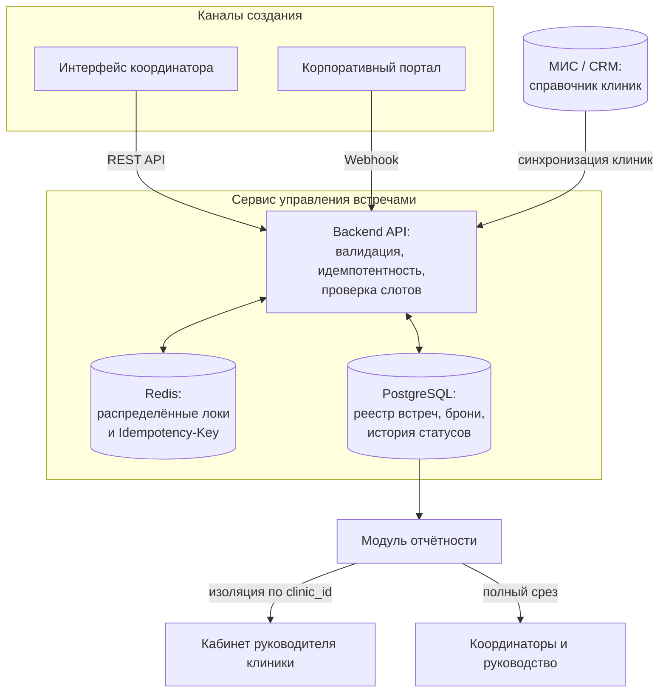
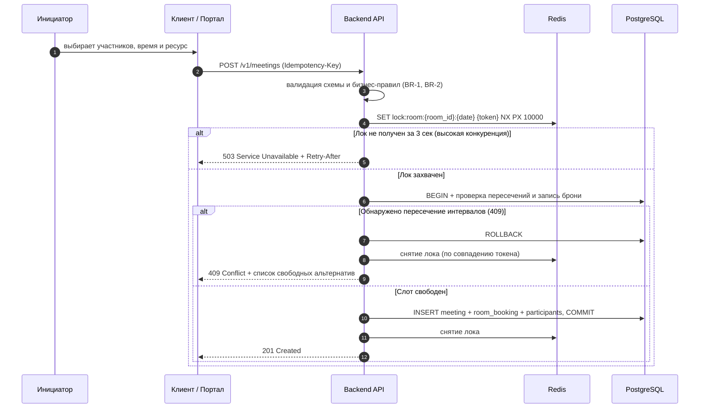
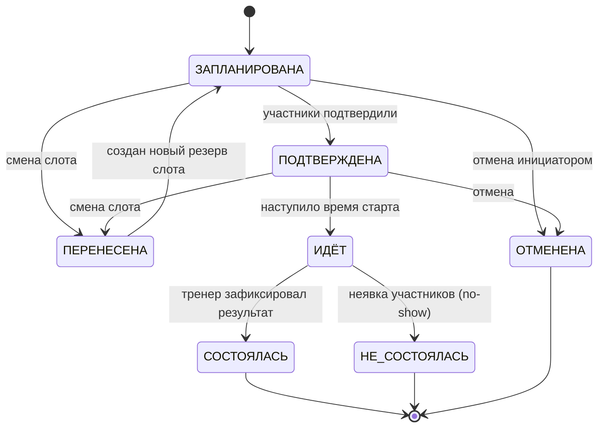
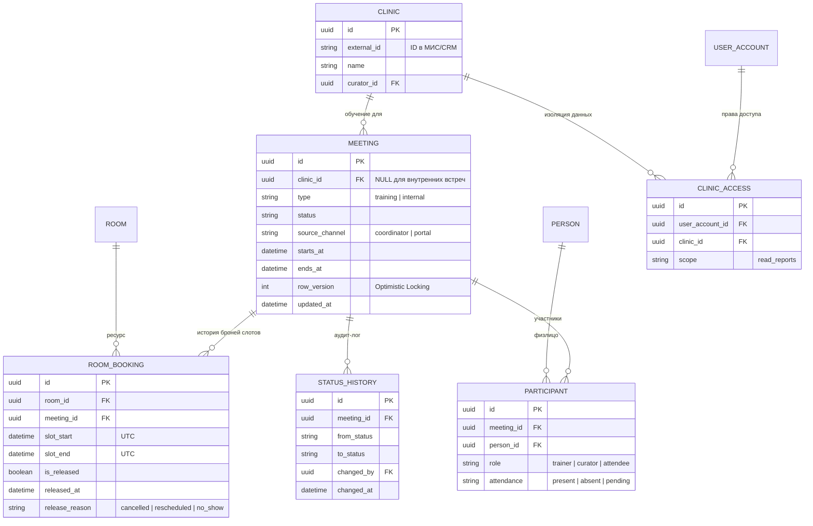

# Кейс 01 · Управление расписанием и бронированием ресурсов

Проектирование единого сервиса управления встречами и ресурсами: внешние обучающие сессии с клиниками-клиентами и внутренние встречи сотрудников конкурируют за общий пул ресурсов.

## 1. Контекст и проблема As-Is

Компания сопровождает сеть клиник-клиентов (онбординг, обучение персонала, кураторство). Параллельно внутри компании проходят регулярные встречи команд. Оба потока конкурируют за ограниченный фонд переговорных и слотов тренеров.

**Проблемы процесса As-Is:**
- **Два изолированных канала записи:** внешние обучения планировали менеджеры внедрения в своей таблице, внутренние встречи сотрудники бронировали через корпоративный портал. Из-за отсутствия единого источника правды постоянно возникали двойные бронирования (овербукинг).
- **Отсутствие жизненного цикла (State Machine):** не фиксировались переносы, отмены и фактическая явка участников; при отмене встречи слот ресурса продолжал числиться занятым.
- **Слепая зона в отчётности и правах доступа:** встречи не привязывались к юрлицам клиник в МИС, а внешним руководителям клиник нельзя было дать безопасный доступ к статистике обучения их сотрудников без риска утечки чужих данных.

## 2. Ролевая модель (RBAC) и мультиарендность

| Роль | Контур | Создание обучающей встречи | Создание внутренней | Назначение тренера | Смена статуса | Доступ к отчётности |
|---|---|---|---|---|---|---|
| Координатор | внутренний | ✓ | ✓ | ✓ | ✓ | полный по всем юрлицам |
| Менеджер по внедрению | внутренний | ✓ | ✓ | ✓ | по своим | по своим клиникам |
| Бизнес-тренер | внутренний | – | ✓ | – | фиксация итога | по своим встречам |
| Менеджер клиник | внутренний | – | ✓ | – | – | по курируемым клиникам |
| Руководитель клиники | внешний (B2B) | – | – | – | – | **строго по своим юрлицам** |
| Сотрудник компании | внутренний | – | ✓ | – | отмена своей | – |

**Ключевое архитектурное решение по безопасности:** руководитель клиники — внешний пользователь, который может владеть несколькими юрлицами (сетью филиалов). Изоляция данных реализована на уровне БД через связку `USER_ACCOUNT → CLINIC_ACCESS → CLINIC`: все аналитические и списочные запросы внешнего контура принудительно фильтруются по списку доступных `clinic_id` из токена сессии.

## 3. Требования

**Функциональные требования и бизнес-правила:**

| Код | Описание |
|---|---|
| FR-1 | Приём заявок на бронирование из двух каналов: интерфейс координатора и вебхуки корпоративного портала |
| FR-2 | Жёсткий запрет на пересечение активных броней одного ресурса во времени |
| FR-3 | Обязательная привязка обучающей встречи к карточке клиники из МИС (`clinic_id`); для внутренних встреч `clinic_id = NULL` |
| FR-4 | Автоматическое освобождение ресурса при переходе встречи в терминальные негативные статусы (`ОТМЕНЕНА`, `ПЕРЕНЕСЕНА`, `НЕ_СОСТОЯЛАСЬ`) |
| BR-1 | Интервалы времени полуоткрытые `[slot_start, slot_end)` — смежные встречи (10:00–11:00 и 11:00–12:00) не конфликтуют |
| BR-2 | Слот бронирования ограничен рабочими часами ресурса и не может пересекать границу суток |

**Нефункциональные требования (NFR):**

| Код | Описание |
|---|---|
| NFR-1 | Защита от гонок (Race Condition): при двух одновременных запросах на один слот первый получает `201 Created`, второй — `409 Conflict` с массивом ближайших свободных слотов |
| NFR-2 | Идемпотентность создания по заголовку `Idempotency-Key` (защита от повторной отправки формы и ретраев сети) |
| NFR-3 | Отказоустойчивость блокировок: падение воркера внутри критической секции не должно блокировать ресурс дольше TTL (10 сек) |
| NFR-4 | Полный аудит-лог переходов статусов (`кто`, `когда`, `старый статус`, `новый статус`) |

## 4. Архитектура целевого решения



## 5. Защита от двойного бронирования (конкурентный доступ)



### Двухуровневая защита инварианта в Redis и PostgreSQL

1. **Уровень приложения (Redis Distributed Lock):**
   Ключ блокировки формируется гранулярно как `lock:room:{room_id}:{date}` (с TTL = 10 секунд и проверкой токена владельца через Lua-скрипт при удалении). Это отсекает параллельные конкурирующие запросы к одной переговорной ещё до открытия тяжёлой транзакции в БД, не блокируя бронирование других комнат.
2. **Уровень ядра БД (PostgreSQL Exclusion Constraint):**
   Чтобы гарантировать целостность данных даже при истечении TTL лока или прямых запросах, на таблице `room_booking` заложено ограничение `EXCLUDE USING gist` по полуоткрытому диапазону `tstzrange`:

```sql
CREATE EXTENSION IF NOT EXISTS btree_gist;

ALTER TABLE room_booking ADD CONSTRAINT room_booking_no_overlap
  EXCLUDE USING gist (
    room_id WITH =,
    tstzrange(slot_start, slot_end, '[)') WITH &&
  ) WHERE (is_released = false);
```

Частичное условие `WHERE (is_released = false)` позволяет хранить в таблице всю историю отменённых и перенесённых броней по одному слоту, проверяя на пересечение только активные резервы.

## 6. Конечный автомат (State Machine) встречи



**Автоматическое освобождение ресурса:** при переходе встречи в статусы `ОТМЕНЕНА`, `ПЕРЕНЕСЕНА` или `НЕ_СОСТОЯЛАСЬ` в рамках одной транзакции у связанной записи `room_booking` выставляется флаг `is_released = true` с фиксацией `released_at` и `release_reason`. Слот мгновенно становится доступен для других сотрудников.

## 7. Модель данных (ERD)



**Обоснование решений в модели данных:**
- **Связь `MEETING (1) — (N) ROOM_BOOKING`:** при переносе встречи мы не перезаписываем `slot_start/slot_end` поверх старой брони, а гасим старую запись (`is_released = true`) и создаём новую. Это сохраняет полную аналитику переносов и простоев комнат.
- **Сущность `PERSON` (обобщение):** во встречах участвуют как штатные сотрудники компании, так и врачи/администраторы клиник-клиентов. Выделение общей таблицы `PERSON` позволяет единообразно отмечать явку любых участников без дублирования внешних ключей.

## 8. BPMN-схема процесса

Схема процесса назначения обучающей встречи в нотации BPMN 2.0 (дорожки: *Менеджер по внедрению → Координатор → Бизнес-тренер → Клиника*, проверка доступности слота и обработка конфликтов):


## 9. Сценарии приёмочного тестирования (UAT / ПСИ)

| # | Тестовый сценарий | Ожидаемый результат |
|---|---|---|
| T-1 | Два параллельных POST-запроса на один и тот же слот одной комнаты | Первый запрос — `201 Created`, второй — `409 Conflict` с предложенными свободными окнами |
| T-2 | Запросы на частично пересекающиеся слоты (10:00–11:00 и 10:30–11:30) | Второй запрос отклонён (`409 Conflict`) |
| T-3 | Запросы на смежные слоты (10:00–11:00 и 11:00–12:00) | Оба запроса успешны (`201 Created`), полуоткрытые интервалы `[)` не конфликтуют |
| T-4 | Повторная отправка запроса с тем же `Idempotency-Key` | Возвращается закэшированный ответ `201 Created` первой операции без создания дубля |
| T-5 | Перевод встречи в статус `ОТМЕНЕНА` и повторная бронь того же слота другим пользователем | Старая бронь получает `is_released = true`, новая бронь на этот же интервал успешно создаётся |
| T-6 | Запрос отчётности из-под внешнего аккаунта руководителя клиники А с подстановкой `clinic_id` клиники Б | `403 Forbidden` (срабатывает фильтр по таблице `CLINIC_ACCESS`) |
