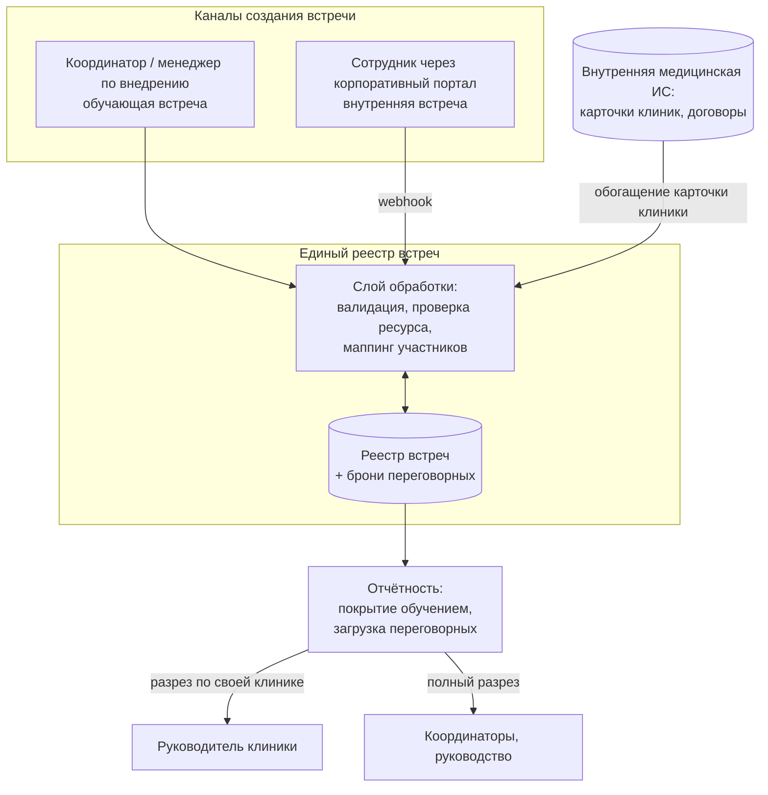
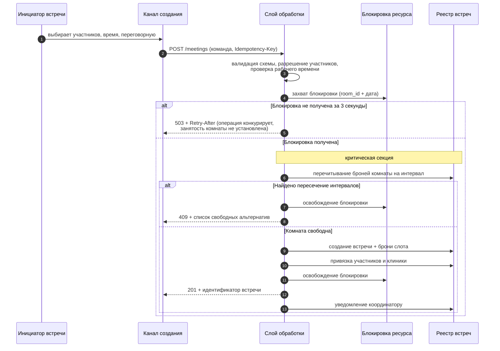
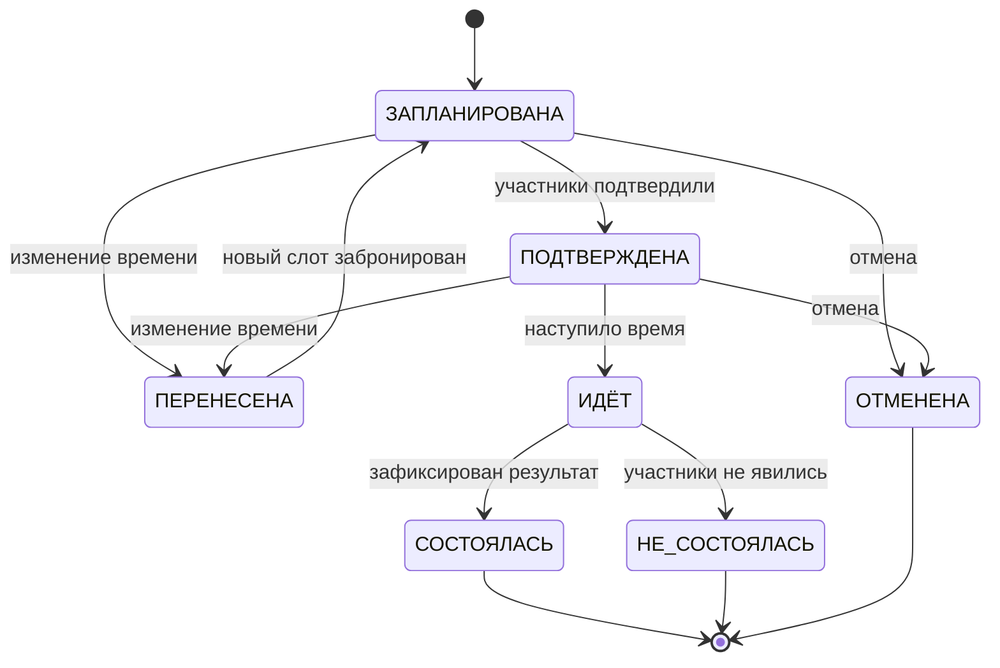
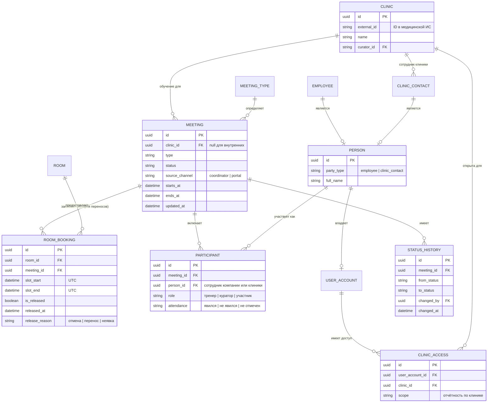
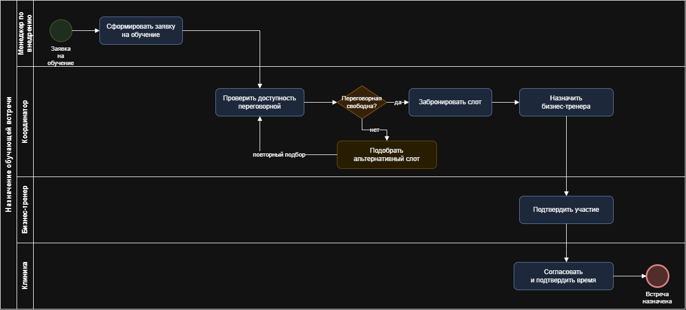

# Кейс 01 · Управление встречами и переговорными

Проектирование единой системы управления встречами: обучающие встречи
с клиниками-клиентами и внутренние встречи сотрудников конкурируют
за общий ограниченный ресурс – переговорные комнаты.

## 1. Контекст

Компания сопровождает сеть клиник-клиентов: обучает персонал работе
с продуктом, ведёт кураторство и отчётность. Параллельно внутри компании
идут собственные встречи сотрудников. Оба потока конкурируют за один
ограниченный ресурс – переговорные комнаты.

## 2. Роли

| Роль | Сторона | Создать обучающую встречу | Создать внутреннюю | Назначить тренера | Менять статус | Отчётность |
|---|---|---|---|---|---|---|
| Координатор | компания | ✓ | ✓ | ✓ | ✓ | полная |
| Менеджер по внедрению | компания | ✓ | ✓ | ✓ | по своим | по своим клиникам |
| Бизнес-тренер | компания | – | ✓ | – | результат обучения | по своим встречам |
| Менеджер клиник | компания | – | ✓ | – | – | по курируемым |
| Руководитель / владелец клиники | клиент | – | – | – | – | по своей клинике |
| Ассистент, врач | клиент | – | – | – | – | – |
| Сотрудник компании | компания | – | ✓ (самообслуживание) | – | отмена своей | – |

Ключевое проектное решение: **руководитель клиники – внешний пользователь**
с доступом к отчётности только по своему юрлицу. Это отдельная ветка
разграничения доступа, а не просто «роль с правами на чтение».

## 3. Процесс as-is и его проблемы

- Обучающие встречи назначает менеджер по внедрению, внутренние –
  сотрудники договариваются между собой в корпоративном портале.
  Два независимых источника, не знающих друг о друге.
- Переговорные бронируются вручную, в отдельной таблице. Двойные брони
  обнаруживаются в момент встречи.
- У встречи нет статусной модели: непонятно, состоялась ли, кто пришёл,
  чем закончилась.
- Встреча не связана с карточкой клиники – нельзя посчитать, какие клиники
  обучены, а какие нет.

## 4. Требования

**Функциональные**

| # | Требование |
|---|---|
| FR-1 | Встреча создаётся из двух каналов: координатором и сотрудником через корпоративный портал |
| FR-2 | Переговорная не может быть забронирована под две пересекающиеся во времени встречи |
| FR-3 | Обучающая встреча связана с карточкой клиники; внутренняя встреча создаётся без клиники |
| FR-4 | Встреча проходит статусную модель, результат обучения фиксируется явно |
| FR-5 | Отмена, перенос и неявка освобождают бронь переговорной |
| FR-6 | Руководитель клиники видит отчётность только по своему юрлицу |

**Бизнес-правила**

| # | Правило |
|---|---|
| BR-1 | Интервалы броней полуоткрытые `[начало, конец)`: касание границ конфликтом не считается |
| BR-2 | Встреча создаётся только в рабочее время переговорной |
| BR-3 | Встреча не может пересекать границу суток – ограничение снимает необходимость составной блокировки |
| BR-4 | Бизнес-тренер назначается только на обучающую встречу |

**Нефункциональные**

| # | Требование |
|---|---|
| NFR-1 | При одновременных запросах на один слот бронь получает ровно один; второй получает отказ с альтернативами |
| NFR-2 | Падение процесса в критической секции не оставляет переговорную заблокированной навсегда |
| NFR-3 | Повторная отправка одной и той же команды создания не порождает вторую встречу (`Idempotency-Key`) |
| NFR-4 | Все переходы статусов журналируются с автором и временем |

## 5. Целевое решение



## 6. Бронирование при конкурентном доступе



**Условие пересечения интервалов.** Интервалы полуоткрытые: `[начало, конец)`.
Две брони конфликтуют, если `начало_A < конец_B` **и** `конец_A > начало_B`.
Проверки «одинаковое время» недостаточно: встреча 10:00–11:00 не совпадает
со встречей 10:30–11:30, но перекрывается с ней. Встречи 10:00–11:00
и 11:00–12:00, наоборот, не конфликтуют – касание границ допустимо.

**Почему блокировка на уровне приложения, а не транзакция БД.** Платформа
не даёт транзакционных гарантий между чтением и записью: между «проверил,
что свободно» и «записал бронь» есть окно, в которое успевает второй запрос.
Блокировка на уровне ресурса это окно сужает, но не устраняет полностью –
см. раздел «Ограничения решения». Целевой вариант при переезде
на транзакционную БД описан ниже.

**Что представляет собой блокировка.** Не переменная в процессе: при двух
экземплярах приложения такая блокировка бесполезна. Используется внешнее
общее хранилище с атомарной операцией «поставить, если не занято»
(`SET key value NX PX <ttl>` в терминах Redis):

| Параметр | Решение |
|---|---|
| Ключ | `lock:room:{room_id}:{дата}` |
| Владелец | случайный токен в значении ключа; снять блокировку может только владелец (сравнение токена перед удалением) |
| TTL | 10 секунд – заведомо больше времени критической секции, но меньше терпения пользователя |
| Ожидание | до 3 секунд с повторами; не получили – технический ответ, а не «занято» |
| Падение процесса | блокировка снимается сама по истечении TTL, ручное вмешательство не требуется |

После захвата блокировки состояние **перечитывается**: между попыткой захвата
и успехом конкурент мог успеть записать бронь.

**Встречи через полночь.** Ключ `room_id + дата` их не закрывает: встреча
23:30–00:30 затрагивает два дня, и два параллельных запроса захватят разные
ключи. Решение: бронирование ограничено рамками одних суток бизнес-правилом
(BR-3). Если ограничение снимут, потребуется захват ключей всех затронутых
дат в порядке возрастания даты – иначе два запроса, идущие «навстречу»,
получат взаимную блокировку.

**Почему ключ блокировки `room_id + дата`, а не глобальная блокировка.**
Глобальная блокировка сериализует вообще все бронирования компании
и превращается в бутылочное горлышко. Ключ по ресурсу и дню даёт
параллелизм там, где конфликта быть не может.

**Целевое решение на транзакционной БД.** Если резервирование переносится
в сервис с PostgreSQL, прикладная блокировка не нужна: инвариант
«одна активная бронь комнаты на пересекающийся интервал» выражается
ограничением уровня БД:

```sql
CREATE EXTENSION IF NOT EXISTS btree_gist;

ALTER TABLE room_booking ADD CONSTRAINT room_booking_no_overlap
  EXCLUDE USING gist (
    room_id WITH =,
    tstzrange(slot_start, slot_end, '[)') WITH &&
  ) WHERE (is_released = false);
```

Тогда пересечение отвергается самой базой, а не порядком выполнения кода.

## 7. Статусная модель



**Правило освобождения ресурса.** Переходы в `ОТМЕНЕНА`, `ПЕРЕНЕСЕНА`
и `НЕ_СОСТОЯЛАСЬ` освобождают бронь переговорной (`is_released = true`).
Забытое освобождение – самая частая дыра в подобных системах: комната
числится занятой встречей, которой не будет.

## 8. Модель данных



**Почему `MEETING 1 – N ROOM_BOOKING`, а не 1 – 1.** Перенос встречи
освобождает старую бронь и создаёт новую. При связи «одна бронь на встречу»
история переносов затирается, и нельзя ответить на вопрос, почему комната
была занята и кем освобождена. Активной считается бронь с `is_released = false`;
именно она участвует в проверке пересечений.

**Почему участники через `PERSON`, а не через `employee_id`.** Во встрече
участвуют не только сотрудники компании: со стороны клиники это руководитель,
врач, ассистент. Прямая ссылка на `EMPLOYEE` не позволила бы их отметить,
хотя отметка явки нужна именно по ним.

**Как реализовано разграничение доступа внешних пользователей.**
Роль сама по себе доступ не ограничивает. Ограничение даёт связка
`USER_ACCOUNT → CLINIC_ACCESS → CLINIC`: при запросе отчётности к фильтру
принудительно добавляется список клиник из `CLINIC_ACCESS` текущего
пользователя. Модель допускает доступ к нескольким клиникам – у владельца
их может быть несколько.

Поле `source_channel` (координатор / портал) – маркер канала создания.
Заложен на этапе проектирования, чтобы без доработок считать, какая доля
встреч идёт через самообслуживание, а какая через координаторов.

## 9. Отчётность

| Метрика | Разрез | Потребитель |
|---|---|---|
| Покрытие клиник обучением | клиника, период | руководство, менеджер по внедрению |
| Доля несостоявшихся встреч | тренер, клиника, период | координаторы |
| Загрузка переговорных | комната, день недели, час | АХО, координаторы |
| Встречи по своей клинике | клиника | руководитель клиники (внешний доступ) |

## 10. BPMN: назначение обучающей встречи

Схема в нотации BPMN 2.0 (draw.io): дорожки «Менеджер по внедрению →
Координатор → Бизнес-тренер → Клиника», шлюз проверки доступности
переговорной, ветка эскалации при занятости.



## 11. Результат

- Двойные брони переговорных прекращены: инвариант проверяется системой,
  а не внимательностью координатора.
- Два независимых потока встреч сведены в один реестр – видно фактическую
  загрузку переговорных по дням и часам.
- Встречи связаны с карточками клиник, поэтому покрытие обучением считается
  запросом, а не ручной сверкой списков.
- Появилась статусная модель: доля несостоявшихся встреч стала измеримой
  величиной, а не предметом обсуждений.

## 12. Ограничения решения

- Блокировка реализована на уровне приложения, а не БД – следствие
  ограничений платформы. Она не даёт транзакционной гарантии: если процесс
  умрёт между записью брони и снятием блокировки, бронь останется, а ключ
  освободится по TTL – это безопасно. Опаснее обратное: истечение TTL
  раньше, чем завершится критическая секция. Защита – TTL с запасом
  и перечитывание состояния после захвата, но полностью исключить гонку
  на этой платформе нельзя. Целевое решение – exclusion constraint
  в PostgreSQL (см. раздел 6).
- Блокировка обязательна только для записей через слой обработки. Прямая
  правка реестра в обход слоя инвариант нарушит, поэтому такой доступ
  закрыт организационно, а не технически.
- Обработка события синхронная, без очереди. При недоступности реестра
  инициатор получает ошибку вместо отложенной обработки.
- Часовые пояса: решение исходит из одного часового пояса. Для
  распределённых команд требуется хранение времени в UTC и приведение
  на клиенте.
- Отчётность строится запросами к оперативным данным. При росте объёма
  нужен отдельный слой агрегатов.

## 13. Проверка конкурентных сценариев

Сценарии, которыми проверялся инвариант «одна активная бронь комнаты
на пересекающийся интервал»:

| # | Сценарий | Ожидаемый результат |
|---|---|---|
| T-1 | Два одновременных запроса на один слот одной комнаты | одна встреча создана (201), вторая получает 409 со списком альтернатив |
| T-2 | Запросы на 10:00–11:00 и 10:30–11:30 | второй отклонён: интервалы пересекаются |
| T-3 | Запросы на 10:00–11:00 и 11:00–12:00 | обе брони созданы: касание границ конфликтом не считается |
| T-4 | Повтор команды создания с тем же `Idempotency-Key` | вторая попытка возвращает первый результат, дубль не создаётся |
| T-5 | Падение процесса после записи брони, до снятия блокировки | бронь существует, ключ снят по TTL, следующий запрос видит слот занятым |
| T-6 | Истечение ожидания блокировки | 503 + `Retry-After`; ответ не утверждает, что комната занята |
| T-7 | Параллельный перенос одной встречи из двух сессий | одна операция успешна, вторая получает конфликт версии |
| T-8 | Отмена встречи | бронь помечена `is_released`, слот доступен для нового бронирования |
