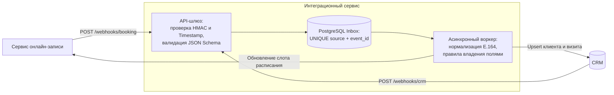
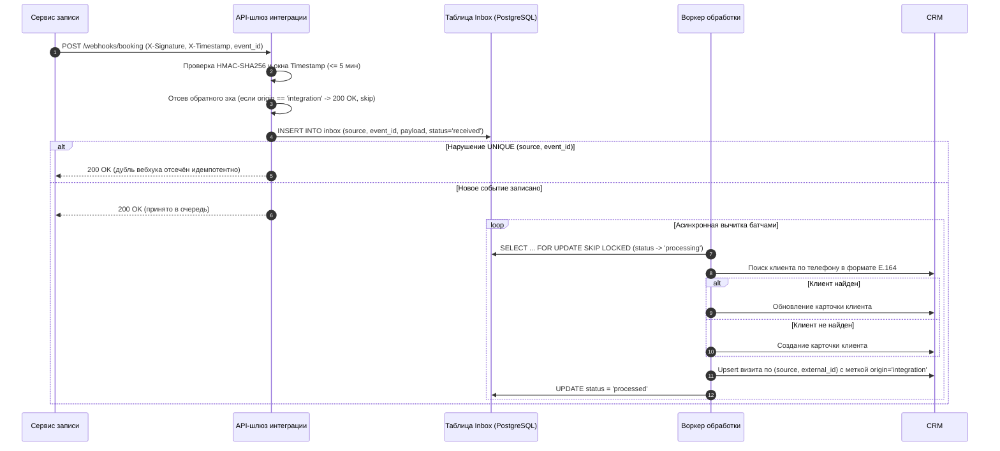

# Кейс 02 · Двусторонняя синхронизация сервиса онлайн-записи и CRM

Событийная интеграция медицинского сервиса онлайн-записи (виджеты и агрегаторы) с корпоративной CRM: идемпотентный приём вебхуков через паттерн Transactional Inbox, дедупликация пациентов и разрешение конфликтов на уровне полей при рассинхронизации.

## 1. Контекст и проблемы As-Is

Клиники принимают потоки онлайн-записи через внешние виджеты и агрегаторы, а операционную воронку (подтверждение, обзвон, листы ожидания) ведут в CRM.

**Боли исходного состояния:**
- Ручной перенос заявок администраторами приводил к задержкам и потере части заявок в пиковые часы.
- Отсутствие нормализации телефонов порождало дубли карточек одного и того же пациента (`8 (999)...`, `+7 999...`), размывая историю обращений.
- При отмене или переносе визита в CRM слот в сервисе онлайн-записи оставался закрытым (простой кресла врача), а при двустороннем включении вебхуков возникал риск бесконечного цикла обновлений («обратное эхо»).

## 2. Требования к интеграции

| Код | Тип | Описание |
|---|---|---|
| FR-1 | Функц. | Синхронизация новой записи из виджета в CRM за время не более 60 секунд |
| FR-2 | Функц. | Двусторонняя синхронизация статусов отмены и переноса времени визита |
| FR-3 | Функц. | Автоматическая склейка и дедупликация карточки пациента по номеру телефона в стандарте `E.164` |
| NFR-1 | Нефункц. | Гарантия доставки `at-least-once` с полной идемпотентностью обработки по `(source, event_id)` |
| NFR-2 | Нефункц. | Защита от обратного эха (бесконечной петли вебхуков между системами) |
| NFR-3 | Нефункц. | Верификация подлинности вебхуков по криптографической подписи `HMAC-SHA256` с защитой от replay-атак |

## 3. Архитектура интеграционного слоя

## 4. Сценарий обработки события (Transactional Inbox)

### Ключевые инженерные решения

1. **Разделение приёма и обработки (Inbox Pattern):**
   Внешняя система ждёт быстрого ответа от вебхука (таймаут 2–3 сек), а внешнее API CRM может отвечать медленно или кратковременно отдавать 5xx. Поэтому вебхук-хендлер только проверяет `HMAC`, атомарно сохраняет сырой `payload` в таблицу `inbox` с ограничением `UNIQUE (source, event_id)` и сразу отдаёт `200 OK`. Вся бизнес-логика и походы в CRM выполняются асинхронно воркерами.
2. **Подавление обратного эха (`origin` + `correlation_id`):**
   Когда наш воркер обновляет сделку в CRM, сама CRM генерирует вебхук об изменении этой сделки и присылает его обратно нам. Чтобы разорвать цикл, каждое изменение от интеграционного сервиса помечается техническим полем `origin = integration` и сквозным `correlation_id`. На входе шлюз игнорирует любые события с `origin == integration`.
3. **Разрешение конфликтов при рассинхронизации (Field-level Ownership):**
   Если запись параллельно изменили и в виджете, и в CRM, правило «Last Write Wins» на весь объект затрёт важные поля. Вместо этого закреплена матрица мастер-систем на уровне атрибутов:

| Группа полей | Мастер-система | Правило разрешения конфликта |
|---|---|---|
| Врач, филиал, слот времени (`starts_at`, `ends_at`) | Сервис записи | Приоритет у расписания клиники; применяется версия с актуальным `updated_at` |
| Статус квалификации лида, комментарии оператора | CRM | Никогда не затираются входящими вебхуками из сервиса записи |
| Отмена визита (`status = cancelled`) | Оба контура | Безусловный приоритет отмены (освобождает слот в расписании и закрывает сделку в CRM) |

## 5. Матрица обработки ошибок и сбоев

| Сценарий сбоя | Реакция системы |
|---|---|
| Невалидная подпись `X-Signature` или `X-Timestamp` старше 5 минут | `401 Unauthorized`, событие отбрасывается, запись в лог безопасности |
| Нарушение JSON Schema контракта | `400 Bad Request` с детализацией поля; ретраи источника не помогут |
| Повторная доставка уже полученного `event_id` | `200 OK` при срабатывании `ON CONFLICT (source, event_id) DO NOTHING` |
| Недоступна БД самого интеграционного слоя (`inbox`) | `503 Service Unavailable` + заголовок `Retry-After` (источник сохранит событие у себя и повторит доставку) |
| CRM возвращает `429 / 5xx` при работе воркера | Событие уже надёжно лежит в `inbox`; воркер увеличивает `attempt_count` и переносит `next_retry_at` по экспоненте (Exponential Backoff). После 5 неудач — статус `failed` (DLQ) и алерт в мониторинг |
| Битый номер телефона, не приводимый к `E.164` | Сделка в CRM создаётся без автосклейки контакта с флагом `needs_manual_merge = true` для ручной разборки оператором |

## 6. Спецификация OpenAPI

Полный контракт входящего API интеграционного шлюза (схемы событий, заголовки безопасности `X-Signature` / `X-Key-Id` для бесшовной ротации секретов, примеры payload и коды ответов) вынесен в отдельный файл:
👉 **[Открыть спецификацию openapi.yaml](./openapi.yaml)**
