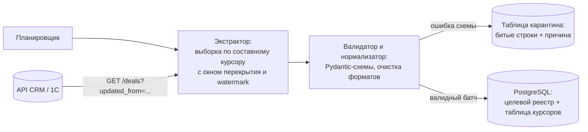

# Кейс 03 · Инкрементальный ETL и синхронизация распределённых реестров

Проектирование отказоустойчивого пайплайна периодической подкачки данных (Delta-ETL) из CRM и учётных систем в операционную БД PostgreSQL: выборка по составному курсору с окном перекрытия, идемпотентный `UPSERT`, карантин невалидных записей и SQL-контроль качества данных.

## 1. Контекст и проблема As-Is

Операционный бэк-офис и аналитические сервисы работают с реестром сделок и заявок, которые первично заводятся менеджерами в CRM и 1С.

**Проблемы исходного процесса:**
- Ручные и полные (Full-dump) выгрузки упирались в квоты и Rate Limits API CRM, а ручная сверка расхождений между базами отнимала у сотрудников часы каждую неделю.
- При падении скрипта посреди выгрузки часть данных терялась, а повторный запуск порождал дубликаты строк.
- «Грязные» данные из CRM (невалидные форматы дат, пустые обязательные привязки, задвоенные внешние ключи) ломали весь батч целиком либо молча искажали отчётность по заявкам.

## 2. Требования

| Код | Требование |
|---|---|
| FR-1 | Инкрементальная загрузка (Delta-pull): за один цикл забираются только созданные и изменённые с прошлого успешного прогона записи |
| FR-2 | Строгая идемпотентность записи в целевую БД (`PostgreSQL`): повторная прокачка того же диапазона обновляет существующие записи (`UPSERT`), не создавая дублей |
| FR-3 | Изоляция битых записей (Quarantine / DLQ): одна некорректная сделка из CRM не должна ронять весь батч — она откладывается в таблицу карантина с причиной ошибки |
| NFR-1 | Соблюдение Rate Limits источника (пагинация + адаптивный троттлинг с обработкой `429 Too Many Requests`) |
| NFR-2 | Атомарность сдвига курсора: при падении воркера посреди батча следующий запуск автоматически дозабирает данные без пропусков |

## 3. Архитектура ETL-пайплайна



## 4. Механика составного курсора и окна перекрытия

Использование одиночного курсора по времени `updated_at` ненадёжно: если 50 сделок обновились в одну и ту же секунду на границе страницы пагинации, часть из них будет пропущена.

### Как спроектирован надёжный забор данных
1. **Составной курсор `(last_updated_at, last_external_id)`:**
   Выборка из источника сортируется детерминированно по `ORDER BY updated_at ASC, id ASC`. Граница продолжения однозначно определяется парой значений.
2. **Окно перекрытия (Lookback Overlap Window = 5 минут):**
   Часы серверов источника и реплики в CRM могут расходиться на секунды (clock skew), а долгие транзакции в CRM фиксируют `updated_at` момента старта, но становятся видимыми в API чуть позже. Поэтому каждый прогон запрашивает данные с `last_updated_at - 5 min`. Повторное чтение недавних сделок безопасно за счёт идемпотентного `INSERT ... ON CONFLICT (external_id) DO UPDATE`.
3. **Верхняя отсечка (`Watermark`):**
   Пайплайн фиксирует верхнюю границу `upper_bound = now()` в начале прогона и запрашивает интервал `[cursor - overlap, upper_bound]`, чтобы не захватывать куски сделок, меняющихся прямо в секунду пагинации.

## 5. SQL-контроль качества данных

Ревизия исторических данных в PostgreSQL строится на аналитических запросах (`CTE`, оконные функции `ROW_NUMBER() OVER (PARTITION BY ... ORDER BY updated_at DESC)`, `LAG/LEAD`) и нацелена на три класса системных дефектов:
- скрытые дубли карточек с разными пробелами/регистром в кодах филиалов;
- «фантомные» заявки, оставшиеся после жёсткого удаления (hard delete) в CRM;
- перезапись более свежих статусов старыми при ретраях.

В целевой таблице PostgreSQL условие обновления защищено проверкой версии времени источника:

```sql
INSERT INTO operational_registry (external_id, clinic_id, status, amount, source_updated_at, synced_at)
VALUES (:external_id, :clinic_id, :status, :amount, :source_updated_at, NOW())
ON CONFLICT (external_id) DO UPDATE
SET
    clinic_id = EXCLUDED.clinic_id,
    status = EXCLUDED.status,
    amount = EXCLUDED.amount,
    source_updated_at = EXCLUDED.source_updated_at,
    synced_at = NOW()
WHERE operational_registry.source_updated_at <= EXCLUDED.source_updated_at;
```

Условие `WHERE operational_registry.source_updated_at <= EXCLUDED.source_updated_at` гарантирует, что даже при перечитывании окна перекрытия старая версия записи никогда не затрёт более свежую.

## 6. Обработка сбоев и краевых случаев

| Ситуация | Поведение пайплайна |
|---|---|
| Обрыв сети или падение процесса на 3-й странице из 10 | Курсор двигается в одной транзакции с записью батча; следующий запуск начнёт с последней подтверждённой страницы |
| Превышение лимита запросов (`429 Too Many Requests`) | Чтение заголовка `Retry-After` + экспоненциальная пауза перед повтором страницы |
| В CRM изменился контракт API (переименовано обязательное поле) | Срабатывает структурная валидация на 1-й странице: прогон аварийно останавливается до записи в БД, в мониторинг уходит критический алерт |
| Невалидные данные в 1 конкретной сделке из 500 | Сделка записывается в таблицу `etl_quarantine (external_id, raw_payload, error_code, attempt_count)`, остальные 499 сделок штатно проходят в реестр |
| Жёсткое удаление сделки в CRM (не ловится по `updated_at`) | Раз в сутки ночью запускается легковесная сверка массива активных `external_id`, помечающая удалённые записи флагом `is_deleted = true` |

## 7. Ожидаемый эффект

- Ручной перенос сделок исключается; реестр отстаёт от CRM не более чем на интервал расписания.
- Ручная сверка таблиц сводится к выборочному контролю карантина (`etl_quarantine`).
- Дубли строк исключены ключом `external_id` и `UPSERT`; потеря заявок на стыке отделов продаж и сопровождения перестаёт зависеть от внимательности исполнителя.
