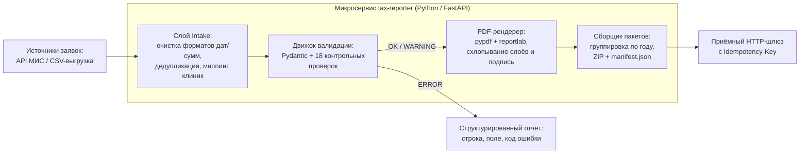

# Кейс 04 · Автоматизация формирования справок для налогового вычета (КНД 1151156)

Проектирование и разработка специализированного микросервиса генерации справок об оплате медицинских услуг для ФНС: приём и нормализация данных по API, двухуровневая валидация (18 контрольных проверок), рендеринг многостраничных PDF-форм и пакетная отправка в шлюз.

👉 **Исходный код работающего сервиса и автотестов:** **[github.com/vfedorov-sa/tax-reporter](https://github.com/vfedorov-sa/tax-reporter)**

## 1. Контекст и проблема As-Is

Клиники обязаны по запросу пациентов формировать справки об оплате медицинских услуг по форме **КНД 1151156** для получения социального налогового вычета и передавать пакеты через электронный шлюз.

**Проблемы ручного процесса As-Is:**
- Данные об оплатах жили в МИС, а паспортные данные, ИНН и реквизиты свидетельств о рождении детей досылались пациентами через внешние формы с кучей опечаток.
- Сотрудники вручную переносили реквизиты в бланки, глазами сверяли суммы и контрольные разряды ИНН. Подготовка одного пакета занимала **3–4 рабочих дня**.
- Ошибки в контрольных соотношениях (например, пациенту исполнилось 14 лет, а указано свидетельство о рождении вместо паспорта, либо не сошлась контрольная сумма 12-значного ИНН) обнаруживались только через несколько дней после отказа приёмного шлюза ФНС.

## 2. Архитектура решения и пайплайн

## 3. Проектирование правил валидации (18 контрольных проверок)

Валидация разделена на два эшелона: базовую типизацию и очистку сырого ввода (пробелы, форматы дат `ДД.ММ.ГГГГ` / `YYYY-MM-DD`, суммы с копейками в `Decimal`) выполняет слой `intake` и `Pydantic`, после чего запускается проверка доменных инвариантов формы КНД 1151156:

| Код контроля | Уровень | Проверяемое бизнес-правило |
|---|---|---|
| `CLINIC_INN` / `CLINIC_KPP` | `ERROR` | Проверка контрольного разряда 10-значного ИНН юрлица по весам ФНС и маски КПП |
| `TAXPAYER_INN` / `PATIENT_INN` | `ERROR` | Проверка двух контрольных разрядов (11-й и 12-й знаки) ИНН физлица |
| `TAXPAYER_INN_MISSING` | `WARNING` | ИНН не указан — справка валидна (сопоставление по ФИО + дате рождения + паспорту), но выводится предупреждение |
| `AMOUNT_EMPTY` | `ERROR` | Сумма по обычному (`код 1`) и дорогостоящему (`код 2`) лечению равна нулю |
| `AMOUNT_OVER_LIMIT` | `WARNING` | Сумма по `коду 1` превышает лимит вычета (120 000 ₽ до 2024 г., 150 000 ₽ с 2024 г.) |
| `PERIOD_AHEAD` / `ISSUED_IN_FUTURE` | `ERROR` | Отчётный год позже года выдачи справки или дата выдачи в будущем |
| `PERIOD_STALE` | `WARNING` | С конца отчётного года прошло более 3 лет (истёк срок давности вычета) |
| `PATIENT_DUPLICATES_TAXPAYER` | `ERROR` | При флаге «пациент и плательщик — разные лица» ФИО и дата рождения совпадают |
| `PATIENT_BIRTH_DATE` / `PATIENT_BORN_LATER` | `ERROR` | У пациента-родственника не указана дата рождения или она позже даты выдачи справки |
| `PATIENT_DOCUMENT` | `ERROR` | Если лечился родственник (ребёнок/супруг), блок удостоверяющего документа обязателен |
| `DOCUMENT_KIND_MINOR` | `ERROR` | Пациенту на дату выдачи `< 14 лет`, но вместо свидетельства о рождении (`код 03`) указан паспорт (`код 21`) |
| `DOCUMENT_KIND_ADULT` | `ERROR` | Пациенту `>= 14 лет`, но указано свидетельство о рождении вместо паспорта РФ |
| `DOCUMENT_ISSUED_LATER` | `ERROR` | Дата выдачи паспорта/свидетельства позже даты выдачи самой справки |
| `DUPLICATE_NUMBER` | `ERROR` | Дублирование номера справки в рамках одной клиники, года и номера корректировки (в пакет уходит последняя версия, предыдущие отклоняются) |

Эндпоинт `POST /v1/certificates/validate` вынесен отдельно, чтобы внешняя форма сбора заявок могла проверять анкету синхронно в момент ввода оператором или пациентом, не дожидаясь пакетной сборки.

## 4. Инженерные решения при генерации PDF и отправке

1. **Декларативная карта координат бланка (`templates/certificate-2025.json`):**
   ФНС регулярно меняет геометрию клеток в бланках КНД. Чтобы не переписывать код рендерера под каждый приказ, координаты ячеек, привязка к полям модели (`source: "taxpayer.birth_date"`) и правила форматирования вынесены в JSON-дескриптор, генерируемый единым скриптом вместе с эталонным PDF.
2. **Решение проблемы кириллицы в AcroForm (Flattening + Overlay):**
   Стандартная подстановка текста в поля PDF-формы (`AcroForm`) ломается на кириллице из-за базового шрифта Helvetica без русских глифов и создаёт редактируемый документ, который отвергается приёмным шлюзом. Реализовано схлопывание полей формы (`_flatten`) с наложением текстового слоя (`reportlab` + TTF `DejaVuSans`) и автоматическим масштабированием кегля длинных названий клиник под ширину ячейки.
3. **Динамическое управление страницами:**
   Если налогоплательщик оплачивал собственное лечение (`patient is None`), сервис автоматически ставит признак `1` («одно лицо»), выставляет число страниц `001` и физически удаляет пустую вторую страницу из PDF.
4. **Надёжная отправка в шлюз:**
   Готовые PDF группируются в ZIP-архивы строго в разрезе отчётных лет (смешивать разные налоговые периоды в одном пакете запрещено контрактом шлюза), снабжаются `manifest.json` и отправляются по HTTP с заголовком `Idempotency-Key: {batch_id}-{tax_year}` и экспоненциальными ретраями на случай сетевых сбоев (`5xx`).

## 5. Результат внедрения

- Время подготовки и выверки пакета справок сократилось **с 3–4 рабочих дней до 2 часов**.
- Формальные ошибки (контрольные разряды ИНН, коды документов несовершеннолетних, даты) отсекаются до генерации PDF, а не после отказа шлюза.
- Сервис покрыт **95 автотестами (`pytest`)**, проверяющими расчёт контрольных разрядов ИНН, все контрольные правила, парсинг «грязных» CSV и геометрию выходного PDF.
